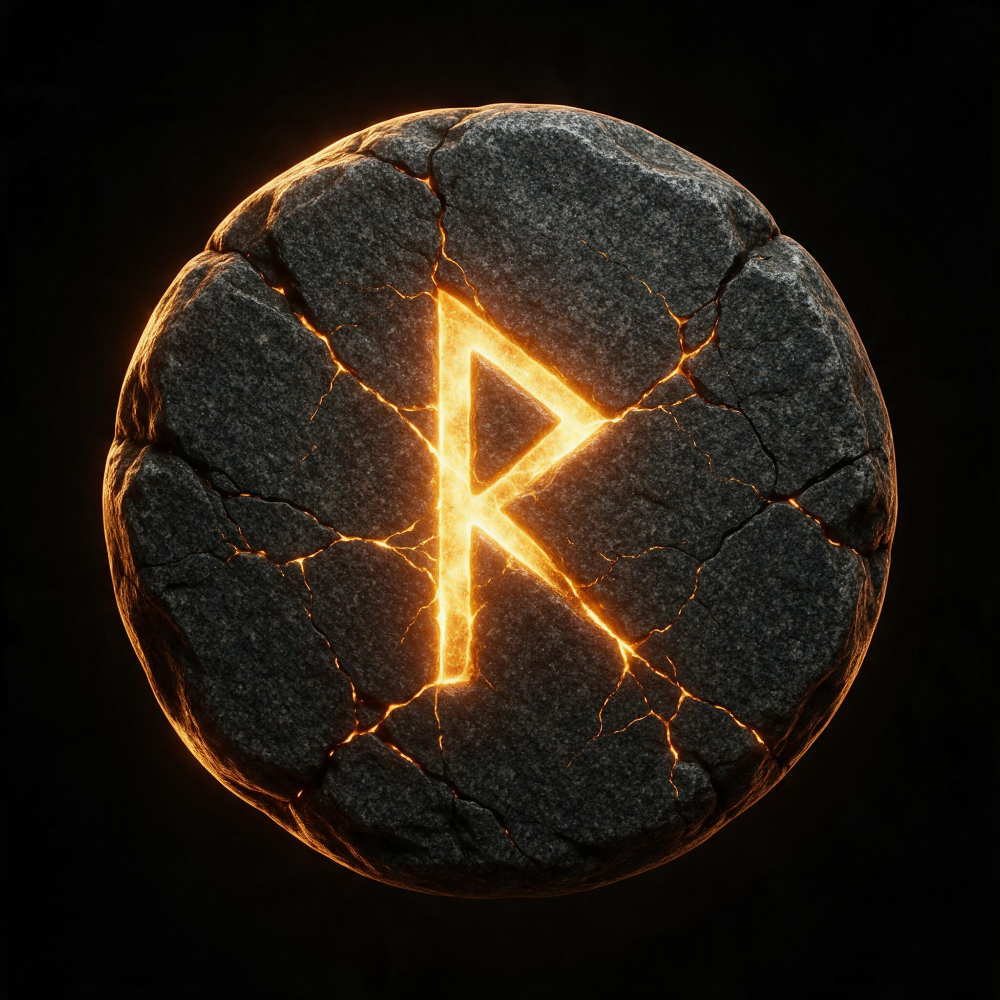
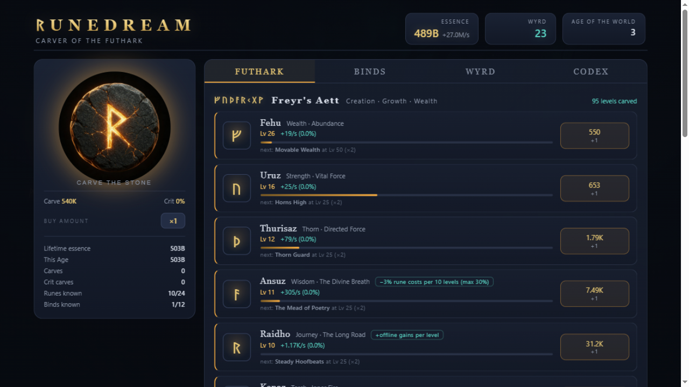
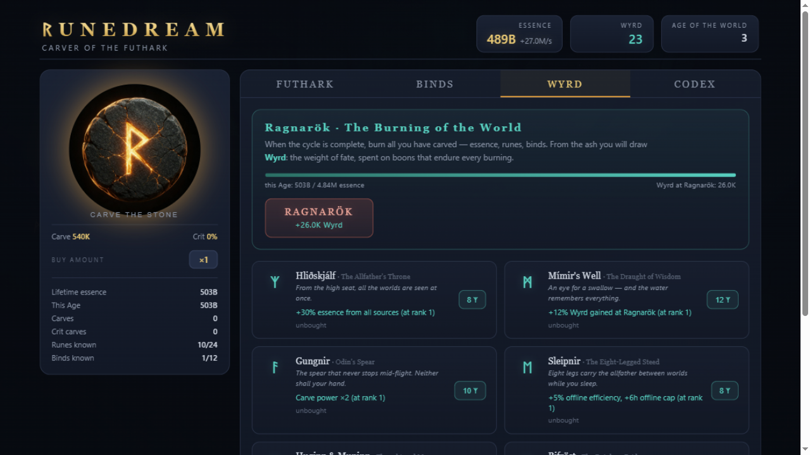

<div align="center">



# ᚱ RuneDream

**Carver of the Futhark — an Elder Futhark idle game**

A dark & mystic incremental game built on the real 24-rune Elder Futhark.
Every rune carries its actual meaning and a verse inspired by the Rune Poems —
and every one of them is a game mechanic.

*One self-contained HTML file. No build. No dependencies. Just carve.*

[Play](#-play) · [Features](#-features) · [The Systems](#-the-systems) · [Balance](#-balance-simulations)





</div>

---

## ▶ Play

**Double-click `index.html`.** That's the whole install.

Or serve it locally (some browsers isolate `file://` storage):

```bash
python -m http.server   # → http://localhost:8000
```

Your progress autosaves to the browser's `localStorage` every 15 seconds and on
close — and the runes keep carving while you're away (50% base efficiency, 12h cap).

## ✦ Features

- **The real Elder Futhark** — all 24 runes in their three aetts, each with its
  genuine meaning, a Rune-Poem-inspired verse, and lore-named milestones
  (*"Cattle Multiply"*, *"The Mead of Poetry"*, *"Wyrd Made Flesh"*…)
- **Carve the stone** — tap the runestone (or press `Space`) for essence, with
  **Perthro**-granted critical carves
- **Rune mastery** — the stone holds a thousand lines. At Lv 1000 a rune may be
  **transcended**: it returns to zero, permanently ×10,000 mightier, and the first
  transcend grants a **unique perk per rune** — 24 different masteries, from
  *Golden Herds* (+25% all essence) to *The Quickening* (runes reborn at Lv 5 after
  every Ragnarök)
- **Rune uniques** — **Ansuz** (wisdom) cuts rune costs, **Raidho** (the long
  road) improves offline gains, **Perthro** (fate's dice) adds crit chance
- **12 bind runes** — fuse two runes at Lv 10 into a named synergy
  (*Twin Flames*, *Ward of the Yew*, *Gift of Inheritance*…), hidden until discovered
- **Ragnarök** — burn the world for **Wyrd**, the weight of fate, and buy boons
  that survive every burning: Hliðskjálf, Mímir's Well, Gungnir, Sleipnir,
  Huginn & Muninn, Bifröst (the stone carves itself)
- **The Codex** — a lore collection that remembers every rune and bind you have
  ever discovered, through the end of every world
- **Mysteries** — whispers drift in from the Norns. Some things in this game are
  never explained: the old words still work, midnight matters, and there may or
  may not be a nameless twenty-fifth rune. The Codex counts what you've found
  (8 to find — no spoilers here)
- **First-carve glow** — when you can afford a rune you've never carved, its row
  lights up so you never miss the moment
- Generated theme art (backdrop + runestone), CSS-carved motion — no assets
  required beyond two bundled images

## ᛉ The Systems

| Currency | Earned | Spent on |
|---|---|---|
| **Essence** ᛝ | carving + rune production | rune levels, bind runes |
| **Wyrd** | Ragnarök | permanent boons |

- **Runes** — passive generators. Each level adds production; milestones at
  10/25/50/100 double a rune's output, then ×2 every further 100 levels.
- **Aetts** — *Freyr's* (creation) opens at the start, *Hagall's* (trials) at 40
  carved levels, *Tyr's* (victory) at 80. The Futhark is the tech tree.
- **Ragnarök** — resets essence, runes and binds; keeps the Codex, Wyrd, boons,
  and a single spark of Fehu ("wealth always returns"). The threshold grows
  ×2.2 each Age, so every world burns a little larger than the last.
- **Offline progress** — production continues while the game is closed; Raidho,
  Sleipnir and the Ward of the Yew bind push efficiency toward 95% and the cap past a day.

## ⚖ Balance simulations

The economy was tuned with a headless simulator that plays **10 player
archetypes** (hardcore clicker, pure idler, casual, ROI optimizer, bind
collector, prestige speedrunner…) through multi-day sessions using the *real
game logic*, sliced live out of `index.html`:

```bash
node tools/balance-sim.js --hours 8
```

Resulting curve: first Ragnarök at **33–60 min** for any sane playstyle, Aett 2
around **1.5–3h**, Aett 3 late in day one for engaged players, tiers 20–24 as
week-scale content. Full data and the five design flaws the sims exposed:
[`tools/balance-report.md`](tools/balance-report.md).

## 🔧 Tech & tuning

Single `index.html` (~1 MB, art embedded as base64) · vanilla JS/CSS ·
runs entirely offline · saves to `localStorage`.

All balance lives in the data tables at the top of the `<script>`:

- **Tier curve** — rune cost/prod generated from `TIER_COST_MULT` / `TIER_PROD_MULT` (4.8 / 4.2)
- **Bind costs** — auto-derived from the pair's tier costs
- `RUNES` (poems, milestones) · `BINDS` (pairs, effects) · `BOONS` (Wyrd shop)
- Constants: `GROWTH` 1.15/level · `RAGNA_THRESHOLD` 1M ×2.2/age · aett gates 40/80 · offline 0.5/12h

Hard reset in-game: **Wyrd tab → "un-carve everything"**.

---

<div align="center">

*The sun turns black, the earth sinks into the sea —*  
*and from the waves, a new world rises.*

**ᛞ RuneDream** · the runes remember

</div>
